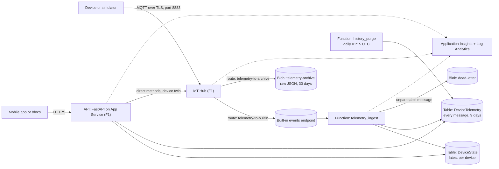

# ems1000-staging

Cloud backend for the EMS-1000 generator monitor: infrastructure as code (Terraform), the
telemetry ingest Function and the REST API the mobile app uses. Everything here runs on Azure
free or near-free tiers for the pilot.

Devices (the ESP32 firmware, or the
[device simulator](https://github.com/okeyf16/ems1000-device-sim)) send telemetry over MQTT to
IoT Hub. A Function stores each message; the API serves the latest state and history, and sends
commands and settings back to the device.

## What is deployed

| Part | Azure service (tier) | Name pattern | Job |
|---|---|---|---|
| Resource group | Resource group | `rg-<app>-<env>` | Holds everything for one environment |
| Device gateway | IoT Hub (F1, free) | `iot-<app>-<env>` | MQTT for devices; routes, direct methods, device twins |
| Ingest | Function App (Linux, Consumption Y1, Python 3.11) | `func-<app>-<env>` | `telemetry_ingest` stores each message; `history_purge` trims history daily |
| API | App Service (Linux, F1, Python 3.11, FastAPI) | `app-<app>-<env>-<suffix>` | `/state`, `/telemetry`, `/command`, `/live`, `/twin` |
| Storage | Storage account (Standard LRS) | `st<app><env><suffix>` | Tables `DeviceState`, `DeviceTelemetry`; blob containers `telemetry-archive`, `dead-letter` |
| Monitoring | Log Analytics (30-day retention, daily cap) + Application Insights | `law-…`, `appi-…` | Logs, traces, metrics, two alert rules, a workbook |

`<app>` is `app_name` (default `ems1000`), `<env>` is `env_prefix` (e.g. `stg`), and
`<suffix>` is a random 4-character string Terraform generates for globally unique names.
Run `terraform output` (or see the HCP Terraform workspace) for the actual names.

## How it fits together



The same picture as text, for viewers that don't render Mermaid:

```
 Device / simulator
        │  MQTT, TLS, 8883
        ▼
 ┌──────────────┐  telemetry-to-archive   ┌───────────────────────────────┐
 │ IoT Hub (F1) │────────────────────────►│ Blob: telemetry-archive (30 d)│
 └──────┬───────┘                         └───────────────────────────────┘
        │ telemetry-to-builtin (events)
        ▼
 ┌────────────────────────────┐   ┌──────────────────────────────────┐
 │ Function: telemetry_ingest │──►│ Table: DeviceState (latest)       │
 │                            │──►│ Table: DeviceTelemetry (9 days)   │
 │                            │──►│ Blob: dead-letter (bad JSON)      │
 └────────────────────────────┘   └──────────────────────────────────┘
 ┌────────────────────────────┐          ▲            ▲
 │ Function: history_purge    │──────────┘(trims)     │ reads
 │ daily 01:15 UTC            │                       │
 └────────────────────────────┘   ┌───────────────────┴──────────────┐
                                  │ API: FastAPI on App Service (F1) │◄── HTTPS ── Mobile app, /docs
 IoT Hub ◄── direct methods, ─────┤                                  │
             device twin          └──────────────────────────────────┘

 Function, API and IoT Hub all log to Application Insights + Log Analytics.
```

Two routes matter: as soon as any custom route exists, IoT Hub only delivers messages where a
route sends them, so `telemetry-to-builtin` must stay for the Function to receive anything.

## Repository layout

```
infra/                       Terraform (run by HCP Terraform, VCS-driven)
  main.tf                    Root: resource group + the five modules
  variables.tf, outputs.tf, providers.tf, backend.tf
  environments/              staging.tfvars, prod.tfvars
  modules/
    iothub/                  Hub, routes, archive endpoint, diagnostics
    storage/                 Account, tables, containers, archive lifecycle rule
    function_app/            Consumption plan + Function App and its settings
    app_service/             F1 plan + Web App (FastAPI) and its settings
    observability/           Log Analytics, App Insights, alerts, workbook
src/
  function/                  function_app.py, host.json, requirements.txt
  api/                       main.py (FastAPI), requirements.txt
.github/workflows/
  deploy-function.yml        Builds and deploys src/function on push to main
  deploy-api.yml             Builds and deploys src/api on push to main
  scaffold..yml              One-off repo reorganisation (manual; no longer needed)
docs/                        Runbook, reference, testing, troubleshooting
```

## How a change reaches Azure

| You change | What happens | Your step |
|---|---|---|
| `infra/**` | HCP Terraform plans automatically on the PR and after merge | Review the plan, then **Confirm & apply** in HCP Terraform |
| `src/function/**` | `deploy-function.yml` builds for the Functions Linux image and deploys | None; check the Actions run |
| `src/api/**` | `deploy-api.yml` zips and deploys to App Service | None; check the Actions run |

Details, first-time setup and rollback are in the [runbook](docs/RUNBOOK.md).

## Documentation

| Document | Read it when |
|---|---|
| [docs/RUNBOOK.md](docs/RUNBOOK.md) | Deploying, adding a device, rotating keys, costs and limits, known issues |
| [docs/REFERENCE.md](docs/REFERENCE.md) | You need an endpoint, a table's keys, a route or an app setting |
| [docs/TESTING.md](docs/TESTING.md) | Checking a deploy worked (smoke tests) |
| [docs/TROUBLESHOOTING.md](docs/TROUBLESHOOTING.md) | Something doesn't arrive, a deploy fails, or a plan looks wrong |

Device-side contract (telemetry fields, direct methods, twin settings):
[device simulator build reference](https://github.com/okeyf16/ems1000-device-sim/blob/main/docs/BUILD_REFERENCE.md).
